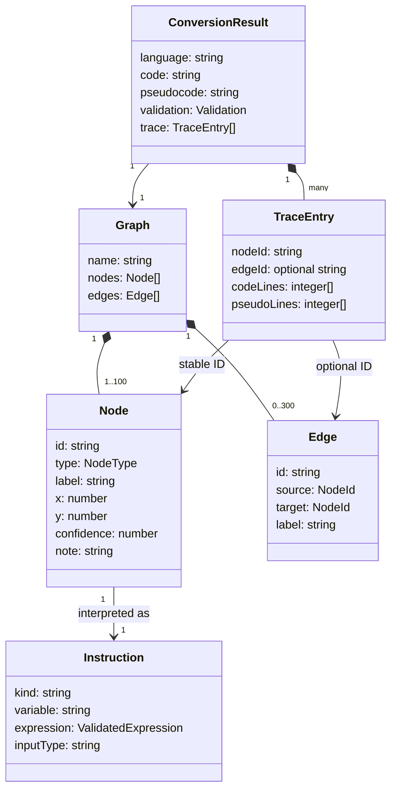
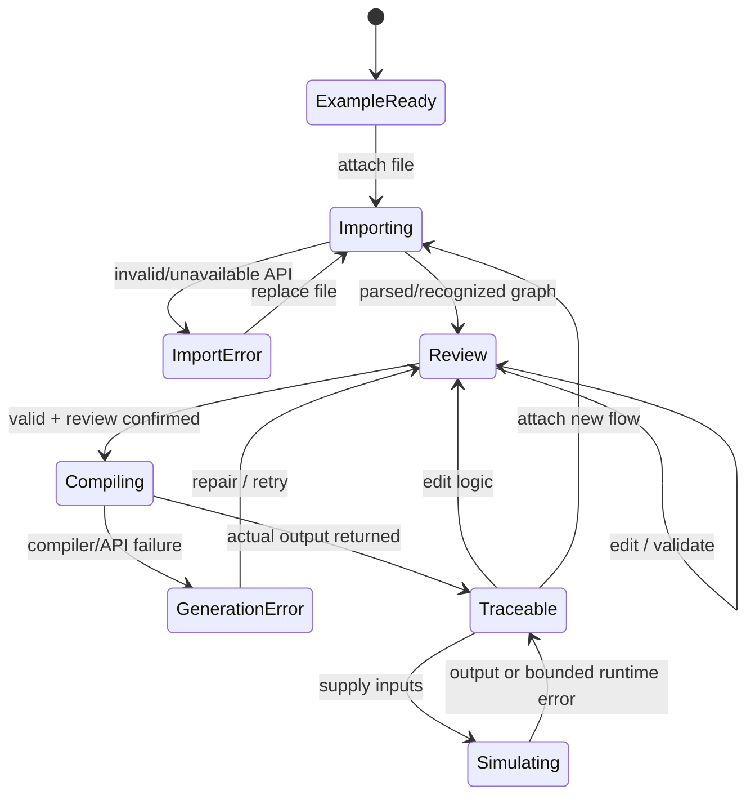
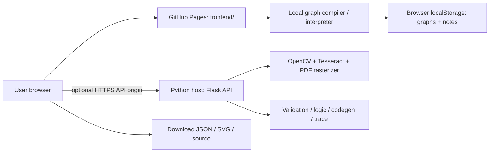

# Modulo — UML and system diagrams

The Mermaid sources below are editable and render in GitHub. They describe the delivered architecture, including the static/runtime separation.

## Conversion sequence

```mermaid
sequenceDiagram
  actor User
  participant UI as Static workspace
  participant Import as Upload/API adapter
  participant API as Optional Flask API
  participant Bus as Python pipeline
  participant Compiler as Browser compiler
  participant Views as Graph/code views
  User->>UI: Attach one single-page file
  UI->>Import: Validate size and extension
  alt Structured JSON / SVG / draw.io / Mermaid
    Import->>Import: Parse structured graph
    Import-->>UI: Graph and original text
  else PNG / JPEG / PDF
    Import->>API: POST /api/analyze (file)
    API->>Bus: Intake + recognition + structural feedback
    Bus-->>API: Graph + uncertainty warnings
    API-->>Import: Review-required recognition result
    Import-->>UI: Editable graph + original preview
  end
  UI->>Views: Reconstruct and mark issues
  User->>UI: Correct labels/types/arrows; confirm review
  UI->>Compiler: Validate graph and executable grammar
  alt Blocking errors
    Compiler-->>UI: Actionable validation messages
  else Valid graph
    User->>UI: Generate language
    alt Explicitly connected compilation API
      UI->>API: POST /api/convert (graph, language)
      API->>Bus: Logic + pseudocode + code + trace
      Bus-->>UI: Generated artifacts
    else Browser-only
      UI->>Compiler: Compile graph state machine
      Compiler-->>UI: Source + pseudocode + trace
    end
    UI->>Views: Show traceable artifacts
    User->>Views: Select node, arrow, or source line
    Views->>Views: Highlight corresponding regions
  end
```

## Domain classes



## Workspace states



## Deployment separation


